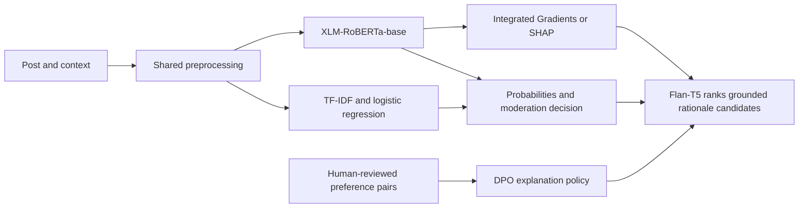

# HateXAI — Hate Speech Detection through Explainable AI and Reward-Optimized LLMs

Bennett University project under **Dr. Pradeepika Verma** (`pradeepika.verma@bennett.edu.in`, N2-WS-062).

A multilingual, explainable, optionally multimodal hate-speech detection prototype. A post is modelled as
`x_i = {T_i, V_i, C_i}` → `y_i ∈ {hate, non_hate, needs_review}`, where `T_i` is text (including
code-mixed language), `V_i` is optional image/meme content, and `C_i` is context. Predictions carry
calibrated probabilities, token-level attributions with measured faithfulness, and an explicit
abstention outcome for ambiguous inputs.

> **Read this first.** The repository is an honest research prototype. Start with [PROJECT_AUDIT.md](PROJECT_AUDIT.md),
> which records exactly what is implemented, what was broken, and what is deliberately **not** claimed.
> Nothing in this README is a benchmark result unless a command is given that reproduces it.

---

## Status at a glance

| Component | State |
| --- | --- |
| Preprocessing, calibrated TF-IDF baseline, robustness + faithfulness evaluation | **Working and reproducible** |
| TF-IDF on the public HateXplain benchmark | **Trained and evaluated on held-out English posts** |
| English and Hinglish research profile | **Trained and evaluated locally on HateXplain and HiFoX** |
| FastAPI backend (`/api/predict`, `/api/explain`, `/api/evaluation`, `/api/feedback`, …) | **Working, tested** |
| HTML/CSS/JS dashboard (detection, explainability, evaluation, feedback, research) | **Working, tested** |
| XLM-RoBERTa-base classifier | **Fine-tuned and evaluated in a matched English/Hinglish CPU pilot** |
| Integrated Gradients and SHAP | **Available in the XLM-RoBERTa profile** |
| Flan-T5 rationale policy and DPO | **Pretrained Flan-T5 runs locally. DPO training and held-out preference evaluation require reviewed pairs.** |
| Meme classification and image attributions | **Optional English pilot using TinyCLIP and captions. The gated XLM-R/CLIP trainer is a separate experiment.** |

The default profile uses the calibrated word and character TF-IDF baseline. The optional research
profile below enables a trained English and Hinglish model and an English meme pilot.

## Advanced text profile



Install the requirements below and prepare the expanded bilingual data from the pinned sources in
the research profile. Run these commands in PowerShell from the repository root.

```powershell
hf download google/flan-t5-small config.json generation_config.json tokenizer.json tokenizer_config.json special_tokens_map.json model.safetensors --local-dir outputs/encoders/flan-t5-small
python scripts/prepare_transformer_pilot.py --output outputs/xlmr-cpu-pilot
$env:OMP_NUM_THREADS = "4"
python scripts/run_pipeline.py --config outputs/xlmr-cpu-pilot/config.yaml --stage transformer
python scripts/run_pipeline.py --config outputs/xlmr-cpu-pilot/config.yaml --stage baseline
python experiments/compare_transformer.py --config outputs/xlmr-cpu-pilot/config.yaml
python experiments/evaluate_transformer_xai.py --config outputs/xlmr-cpu-pilot/config.yaml
python experiments/compare_transformer.py --config outputs/xlmr-cpu-pilot/config.yaml --context-manifest data/processed/cadd-v1/manifest.json
$env:HATEXAI_CONFIG = "configs/english_hinglish_ngrams.yaml"
python -m uvicorn backend.main:app --host 127.0.0.1 --port 8001
```

For the full 46,662-row training set, use `configs/xlm_roberta.yaml` for training, comparison
and serving. Start with the existing TF-IDF checkpoint from the character 3–5-gram run. The full
profile trains the last four encoder layers and the head by default. Set `train_encoder_layers`
to 12 to fine-tune the whole encoder. CUDA requires a CUDA-enabled PyTorch build. Tune batch
size and sequence length to available VRAM. CPU runs use host RAM and are substantially slower
on the full corpus. Allow a few GB of disk space for pretrained and saved weights.

Open [Analyze](http://127.0.0.1:8001/analyze.html) for the presentation. TF-IDF is selected by default.
Choose **XLM-RoBERTa (research pilot)** in the Model menu to see Integrated Gradients, SHAP,
and Flan-T5 on the same page. Both comparison rows are available on the dashboard.

The app loads a saved classifier and its validation-selected cutoffs. An absent or invalid
XLM-R checkpoint or evaluation triggers the configured TF-IDF fallback. The profile identifies
the loaded classifier and available methods in `GET /api/model-info`. Set `classifier: "baseline"`
in prediction or explanation requests to compare with TF-IDF. Use `classifier: "transformer"`
to select the research checkpoint explicitly. For example:

```json
{"text":"Aaj library open hai. Everyone is welcome.","classifier":"transformer","method":"integrated_gradients"}
```

Submit that body to `POST /api/explain`. XLM-R also supports `shap`, with more forward passes
on longer inputs. Both methods explain the predicted binary class and show token scores,
guided versus random masking, and an independent review verdict. Flan-T5 selects among concise
evidence-only rationales and can include uncertainty language. Qualitative intent and label
disagreements still require a human reviewer.

To train and evaluate DPO, supply separate reviewed `reviewed_train.jsonl` and
`reviewed_test.jsonl` files at the paths in the full config. Each row needs `id`, `text`,
optional `context`, the reviewed classifier-evidence `prompt`, `chosen_explanation`,
`rejected_explanation`, `review_status: "accepted"` and `reviewer_id`. Use distinct source
posts between splits. No feedback submissions are imported automatically.

```powershell
python scripts/run_pipeline.py --config configs/xlm_roberta.yaml --stage dpo
python scripts/run_pipeline.py --config configs/xlm_roberta.yaml --stage dpo-eval
```

The comparison reports are in the profile's evaluation directory. The pilot used 768 stratified
training posts, 320 validation posts and 768 test posts per model. It measures English HateXplain
and Hinglish HiFoX performance in their respective corpora. The comparison cannot isolate
language from dataset effects. DPO evaluates agreement with held-out human preferences by
completion scores. This is a separate explanation measure and leaves classifier weights independent.

---

## Quick start

Requires Python 3.10+.

```bash
python -m venv .venv
source .venv/Scripts/activate        # Windows Git Bash; use Activate.ps1 in PowerShell
pip install -e .
pip install -r requirements.txt
```

### Optional local research profile

Use the pinned HateXplain release and the authors' [HiFoX Task A files](https://huggingface.co/datasets/yashbleh/HiFox_Dataset/tree/420bcd5a129be5c9ecf362a0579aafdef30fdc01)
under `data/raw/hifox/`. HiFoX permits local research and requires author permission for publication.
The context experiment uses the authors' [CADD split files](https://github.com/nlpcl-lab/CADD_dataset/tree/090f41c26976b2f763ff445cd6d5840d42a4ddeb/Dataset)
under `data/raw/cadd/`. The CADD README specifies CC BY-SA 4.0.

```powershell
python scripts/prepare_public_data.py --profile english-hinglish --output data/processed/english-hinglish-v1
python scripts/run_pipeline.py --config configs/english_hinglish.yaml --stage baseline
python scripts/prepare_public_data.py --profile cadd --output data/processed/cadd-v1
python experiments/compare_context.py
python experiments/compare_language_policy.py
```

The expanded training experiment adds the CADD training comments and the Hinglish rows from
[Srivastava et al.](https://doi.org/10.1007/978-981-16-3067-5_8). Save the authors'
[pinned CSV](https://github.com/bhargavyagnik/Hateful_speech_Hinglish_social_media_Paper/blob/c7e831de82ae5894dced27ad66aa840b7735ca3e/Hate_speech_dataset.csv)
under `data/raw/hinglish-yagnik/`. The authors specify research use. The dataset builder
checks input digests, removes training overlap, and copies the original validation and test
files byte for byte. The experiment runs on CPU and produces a separate checkpoint.

```powershell
python scripts/extend_public_training.py --reference data/processed/english-hinglish-v1 --extra data/processed/cadd-v1 --hinglish data/raw/hinglish-yagnik/Hate_speech_dataset.csv --output data/processed/english-hinglish-v2
$env:OPENBLAS_NUM_THREADS = "2"
$env:OMP_NUM_THREADS = "2"
python scripts/run_pipeline.py --config configs/english_hinglish_extended.yaml --stage baseline
python scripts/run_pipeline.py --config configs/english_hinglish_ngrams.yaml --stage baseline
```

The second run uses the same data with character 3–5-grams. Both write their own training
metadata, validation metrics, held-out metrics, and review cutoffs under `outputs/`.

For the meme pilot, save the pinned [Multi3Hate Parquet file](https://huggingface.co/datasets/MinhDucBui/Multi3Hate/tree/e3692a908ade3952bd70bb0cc1ca5eac8b23663c/data)
as `data/raw/multi3hate/memes.parquet`. Its CC BY-NC-ND terms apply. Keep this pilot local for
noncommercial research. Save `config.json`, `preprocessor_config.json` and `pytorch_model.bin` from
[TinyCLIP](https://huggingface.co/wkcn/TinyCLIP-ViT-8M-16-Text-3M-YFCC15M/tree/b6ffcf486212e8f3863b8009a4021dbea481b817)
under `outputs/encoders/tinyclip/`.

```powershell
python experiments/train_meme_pilot.py
$env:HATEXAI_CONFIG = "configs/english_hinglish_ngrams.yaml"
$env:OMP_NUM_THREADS = "2"
python -m uvicorn backend.main:app --host 127.0.0.1 --port 8001
```

To serve the original bilingual checkpoint from the first training command, use
`configs/english_hinglish.yaml`. The meme pilot requires a supplied caption. Its overlay measures
the score change when each of nine image regions is covered. CADD context and threshold-based disparity comparisons are offline
experiments. Reports and checkpoints are stored under `outputs/`.

### 1. Generate reproducible evaluation artifacts

```bash
python experiments/run_experiments.py --config configs/default.yaml
```

This writes `outputs/eval/*.json` (metrics, calibration, operating point, probes, ablation, faithfulness,
comparison). The service trains the baseline if no checkpoint exists.

### 2. Run the backend + dashboard

```bash
uvicorn backend.main:app --host 127.0.0.1 --port 8000
```

Open <http://127.0.0.1:8000/>. The frontend is served from the same origin as the API, so no CORS
configuration is needed in the common case. Interactive API docs are at `/docs`.

After training the public baseline, serve the saved English HateXplain model and its evaluation artifacts
by setting `HATEXAI_CONFIG` to `configs/hatexplain_baseline.yaml` before launching Uvicorn. In PowerShell:

```powershell
$env:HATEXAI_CONFIG = "configs/hatexplain_baseline.yaml"
python -m uvicorn backend.main:app --host 127.0.0.1 --port 8000
```

The public profile loads the saved checkpoint and validation-derived review band. The API returns
`decision` for the three-way moderation outcome and retains the binary `label` for model attribution.

### 3. Run the tests

```bash
python -m pytest tests -q
```

---

## Baseline and multimodal research paths

```
text + context ──► canonical fusion ──► TF-IDF (word+char) ──► logistic regression ──► Platt calibration
                                              │
                                              ├──► LIME / occlusion attribution ──► token evidence + faithfulness
                                              └──► cost-weighted threshold ──► hate | non_hate | needs_review

(optional, implemented, not trained here)
XLM-R text encoder + frozen CLIP vision ──► gated fusion ──► classifier
Flan-T5 explanation policy ──► DPO over chosen/rejected rationales
```

Key design decisions, and why:

- **One canonical input string.** Baseline and transformer both call `hatexai.data.preprocess.fuse_text`, so
  they see identical features. Previously the transformer also received `Language:`/`CodeMixed:` tokens the
  baseline did not, which confounded comparison (audit §3.6).
- **Calibrated probabilities, then a cost-weighted threshold.** Calibration does not change ranking (AUROC is
  unchanged) but makes the abstention band meaningful.
- **Three-way output.** `needs_review` is a first-class outcome; abstentions are counted, not hidden.
- **Attribution and its evaluation share one masking mechanism**, so an explanation cannot drift from the
  faithfulness number reported next to it.

---

## Measured results (reproducible)

### Public HateXplain benchmark

```bash
python scripts/run_pipeline.py --config configs/hatexplain_baseline.yaml --stage baseline
```

Run the `hatexplain` data preparation command below first. Training uses the existing word and
character TF-IDF model with logistic regression and three group-aware calibration folds on CPU.
The test split is evaluated after the checkpoint is saved and the review band is selected on validation.

| Split | N | Macro F1 | Macro precision | Macro recall | Accuracy | FPR | FNR |
| --- | ---: | ---: | ---: | ---: | ---: | ---: | ---: |
| Validation | 1,920 | 0.795 | 0.822 | 0.779 | 0.836 | 0.072 | 0.369 |
| Test | 1,924 | 0.792 | 0.813 | 0.778 | 0.832 | 0.082 | 0.362 |

At the binary decision threshold, the test confusion matrix was `[[1221, 109], [215, 379]]`,
with rows for gold non-hate and hate. AUROC was 0.877, Brier score was 0.125 and ECE was 0.020.
The validation-selected review policy routed 284 test posts (14.8%) to human review. All test
records have the English release label. Evaluation across languages requires additional licensed data.
The checkpoint and JSON reports are written under `outputs/hatexplain-baseline-v1/`.

```bash
python experiments/evaluate_public_baseline.py --config configs/hatexplain_baseline.yaml
```

This evaluates the saved checkpoint. The binary false-positive rate was 5.5% for the source
`normal` class (43/782) and 12.0% for `offensive` (66/548). For the 1,812 test posts with more
than five tokens, mean occlusion comprehensiveness was 0.096 versus 0.031 for a seeded random
mask. With only the five selected tokens retained, mean predicted-class probability was 0.832
versus 0.757 for five random tokens. The reports record the checkpoint and test checksums.

Run `python experiments/evaluate_public_baseline.py --config configs/hatexplain_baseline.yaml --analysis ablation`
for the fixed feature comparison. Uncalibrated character, word, and union variants achieved test
macro F1 of 0.723, 0.792, and 0.793. The group-calibrated union achieved 0.792. Its ECE was 0.020
versus 0.104 for the uncalibrated union. The calibration procedure also ensembles fold models.

### Synthetic diagnostics

Run `python experiments/run_experiments.py` to regenerate. Generated on the bundled diagnostic data.

**Ablation (selection by train-only 3-fold CV; test/probe are held-out reports):**

| Feature set | Calibrated | CV macro-F1 | Test acc. | Brier | ECE | Probe acc. | Probe (unambiguous) |
| --- | --- | --- | --- | --- | --- | --- | --- |
| char (legacy) | no | 0.706 | 0.667 | 0.236 | 0.149 | 0.639 | 0.710 |
| word | no | 0.747 | 1.000 | 0.213 | 0.462 | 0.750 | 0.774 |
| word | yes | 0.790 | 1.000 | 0.079 | 0.265 | 0.806 | 0.839 |
| union | no | 0.746 | 1.000 | 0.202 | 0.448 | 0.750 | 0.806 |
| **union** | **yes** | **0.831** | 1.000 | 0.087 | 0.271 | 0.750 | 0.806 |

**Robustness on the 36-item adversarial probe set:** at the 0.5 decision threshold, overall accuracy **0.750** (unambiguous
subset **0.806**); at the cost-weighted operating point actually served (θ = 0.394, fn:fp = 5:1) it is **0.639** with
FPR **0.500** and FNR **0.083** — recall is bought with false positives. The model still fails systematically on **quoted hate**, **counterspeech**, and
**neutral identity mentions** that contain abusive words — see `outputs/eval/probes.json`.

**Honest reading of these numbers:**

- The test split has only **6 examples**, so its accuracy moves 16.7 points per flipped item. It is not evidence.
- Cross-validation is over **24 training examples**. The ablation is directional, not conclusive.
- The probe set is **author-constructed**, deliberately adversarial, and not a public benchmark. It is useful
  because it exposes failure modes, and it is labelled as contested where the label itself is debatable.
- These demo results cover the baseline. The advanced profile reports the separate XLM-R CPU pilot.

**Baseline reference (pre-improvement):** the original char-only baseline scored acc 0.667 / AUROC 0.778 on the
test split and 0.639 on the probes; the audit documents why.

---

## API

| Method | Path | Purpose |
| --- | --- | --- |
| GET | `/health` | Liveness and model-load status |
| GET | `/api/model-info` | Architecture, languages, modalities, limitations, responsible use |
| POST | `/api/predict` | Decision + calibrated probabilities + uncertainty |
| POST | `/api/explain` | `/api/predict` plus token attributions and faithfulness (`method`: `lime` or `occlusion`) |
| POST | `/api/vision-check` | Validates PNG/JPEG/WebP file type, 5 MB size limit, and full decodability |
| GET | `/api/evaluation` | All evaluation artifacts, with an explicit `missing` list |
| POST | `/api/feedback` | Submit a report → stored as a **review candidate** |
| GET | `/api/feedback` | Review queue (latest status merged from the review log) |
| GET | `/api/feedback/summary` | Counts by review status |
| POST | `/api/feedback/{id}/review` | Record a human review decision |

Example:

```bash
curl -X POST http://127.0.0.1:8000/api/explain \
  -H "Content-Type: application/json" \
  -d '{"text":"These people are vermin and should leave.","method":"occlusion"}'
```

Response fields include `label`, `probability_hate`, `confidence`, `uncertainty`, and an `explanation` object
with `tokens`, `scores`, `top_evidence`, `rationale`, `faithfulness`, and a `disclaimer`.

Backend guarantees: input length limits enforced at the schema boundary; the model is loaded **once per
worker**; inference errors return a clean 500; CORS is an explicit allow-list; a per-client rate limit applies;
uploads are temp-file cleaned; no secrets are read from or written to the repository.

---

## Frontend

Plain HTML5 + CSS3 + vanilla JavaScript in `frontend/` — no framework, no build step, no Streamlit.

- `index.html` — landing page with an animated neural-network hero and feature cards
- `analyze.html` — detection workspace with token attributions, uncertainty, report handoff, and image
  file validation. Image classification requires a trained vision model.
- `dashboard.html` — evaluation dashboard: metrics, confusion matrix, decision policy, system comparison,
  ablation, robustness, faithfulness
- `feedback.html` — report form + human review queue
- `research.html` — model, languages, datasets, methodology, limitations

Accessibility and motion: keyboard-navigable, `focus-visible` outlines, and a full
`prefers-reduced-motion` path. The dashboard shows skeleton loaders and explicit empty/unavailable states
instead of invented numbers.

The legacy `app/streamlit_app.py` is retained but **deprecated**; Streamlit is no longer a dependency.

---

## Training the transformer and DPO (optional)

These require model downloads and, realistically, a GPU.

```bash
python scripts/run_pipeline.py --config configs/cpu.yaml --stage classifier   # DistilBERT-multilingual
python scripts/run_pipeline.py --config configs/default.yaml --stage dpo      # Flan-T5 + DPO
```

Transformer training uses **class-weighted cross-entropy**, best-checkpoint selection, and early stopping.
For DPO, set `dpo.preferences_path` to a separate JSONL file of human-reviewed training pairs. Each row needs
`id`, `text`, distinct `chosen_explanation` and `rejected_explanation` strings, `review_status: accepted`,
and a pseudonymous `reviewer_id`. An optional `context` field supplies conversation context. Use source
posts from the training split and reserve separate reviewed pairs for explanation evaluation.

The T5 completion score matches its teacher-forced loss and includes the first target token. Successful
DPO runs save the explanation policy and `training_history.json` together under `checkpoints/dpo_policy/`.
The history includes epoch loss, pair counts and a checksum of the reviewed input file.

**Hardware guidance:** the shipped baseline and the whole test suite run on CPU in well under a minute.
`configs/cpu.yaml` (DistilBERT-multilingual + Flan-T5-small) needs roughly 8 GB RAM and no GPU but will be
slow; `configs/default.yaml` (XLM-R-base + CLIP) is intended for a ≥12 GB GPU. The CPU configs are for
smoke-testing the code path, not for producing paper numbers.

---

## Data

| Asset | Location | Notes |
| --- | --- | --- |
| Synthetic wiring set | `data/synthetic/` | 24 train / 6 val / 6 test (36 records, counted from disk). Illustrative only; **not a benchmark** |
| Adversarial probes | `data/probes/hard_cases.jsonl` | 36 author-constructed diagnostic cases, with an `ambiguous` flag |

Use the release-aware profiles in [configs/public_data.yaml](configs/public_data.yaml). Run these commands
from the repository root. Keep authorized source files and generated data under the ignored
`data/raw/` and `data/processed/` directories.

| Profile | Required source files | Label policy |
| --- | --- | --- |
| `hatexplain` | `Data/dataset.json`, `Data/post_id_divisions.json`, and `LICENSE` from the [pinned HateXplain release](https://github.com/hate-alert/HateXplain/tree/01d742279dac941981f53806154481c0e15ee686), saved under `data/raw/hatexplain/` | Take the majority among the original three classes, then map only `hatespeech` to 1. Preserve the original votes, tokens and rationale masks. |
| `multilingual` | The HateXplain files and authorized [HASOC 2021](https://hasocfire.github.io/hasoc/2021/dataset.html) English and Hindi subtask 1 train/test exports with `task_1` and fine labels in `task_2`. Place the exports at the paths in the profile or set the paths in a local config. | Map `HATE` to 1 and `NOT`, `OFFN` and `PRFN` to 0. Exclude coarse-only `HOF` because it combines hate, offensive speech and profanity. |
| `hateful-memes` | Authorized [Hateful Memes](https://www.drivendata.org/competitions/64/hateful-memes/) Phase 2 archive with `train.jsonl`, `dev_unseen.jsonl`, `test_unseen.jsonl` and `img/` | Keep official binary labels and preserve unlabeled test IDs. |

```bash
python scripts/prepare_public_data.py --profile hatexplain --output data/processed/hatexplain-v1
python scripts/prepare_public_data.py --profile multilingual --authorized-sources --output data/processed/multilingual-v1
python scripts/prepare_public_data.py --profile hateful-memes --authorized-sources --output data/processed/hateful-memes-v1
```

The output directory is versioned by the caller. Each build writes split JSONL files, an exclusion log
and a manifest with source revisions, input/output SHA-256 digests, and label, language, code-mix,
image and duplicate group counts. A meme test set without labels is written to `test_unlabeled.jsonl`.
Image paths refer to the local dataset directory from the profile. Run image consumers from the same
working directory or configure an absolute dataset root.

Official test IDs stay in test. Exact text matches, near text matches at character-trigram Jaccard
similarity of at least 0.85 for strings of 20 or more characters, and exact or perceptually similar
images form groups across inputs. The build removes overlapping rows from train or validation in
favor of the higher-priority split. It derives HASOC validation from eligible training groups.
The rule can remove shared meme captions or related images from development data. The manifest
records these exclusions for reporting. The `language` field refers to the release, and the
`code_mixed` flag detects Latin/Indic script mixing. Romanized-only code mixing requires independent
annotation. The broad-label HASOC conversational track is outside the strict hate label profile.

The HateXplain build was verified on the official data with 15,335 train, 1,920 validation and 1,924
test rows. HASOC and Hateful Memes require authorized local archives for end-to-end verification.
The original `--input` converter remains available for legacy files. Use the profile commands for
benchmark preparation.

JSONL record format:

```json
{"id":"tr_001","text":"...","label":1,"language":"hi","code_mixed":true,
 "context":"reply thread","image_path":null,
 "chosen_explanation":"HATE. ...","rejected_explanation":"NON_HATE. ..."}
```

---

## Repository layout

```
PROJECT_AUDIT.md          audit: what exists, what was broken, what is claimed
src/hatexai/              library: data, baselines, models, train, eval, reward, xai
backend/                  FastAPI app, schemas, model registry, feedback store
frontend/                 HTML/CSS/JS dashboard
experiments/              reproducible experiment runner → outputs/eval/*.json
configs/                  default (GPU) and cpu configs, with baseline + decision-policy settings
tests/                    metrics, thresholds, robustness, XAI, DPO alignment, API
paper/                    ACL draft and bibliography
slides/                   defense deck
```

---

## Limitations and responsible use

- The default demo model is trained on 24 synthetic examples. Its probabilities on the 6-record
  demo test split are compressed near 0.5.
- The optional meme pilot was evaluated on one small English benchmark. It requires human review
  and a supplied caption. The default profile offers image file validation.
- Attribution is **not** evidence of intent, and generated rationales are displayed separately from
  model-derived evidence.
- Hate-speech labels are culturally contested; the probe set marks contested cases explicitly.
- Feedback is a review queue, never an automatic training signal, and never enters the evaluation split.
- Do not use this as the sole basis for punitive action against a person or account. Keep a human in the loop.

## Citation

See `paper/acl_paper.tex` and `paper/references.bib`. The current project deck is
`slides/presentation.html`. The milestone deck is the historical review.

To build the paper, place the TeX source, bibliography, `acl.sty` and `acl_natbib.bst` in a build directory
and run `tectonic --keep-logs acl_paper.tex` there. The verified build used Tectonic 0.17.0 and the
[ACL style at revision d5adc82](https://github.com/acl-org/acl-style-files/tree/d5adc823ff0f80f98c80405ca0ab66c68e684409).

The regular build reports the English HateXplain benchmark. The internal project review build
uses `hatexai_current.tex` and `internal_progress.tex` in `outputs/paper-current/`. Build
it there with `tectonic --keep-logs hatexai_current.tex`. The internal build includes the
bilingual, context, transformer, meme and attribution results. Retain the HiFoX publication
restriction when sharing the work outside internal project review.
